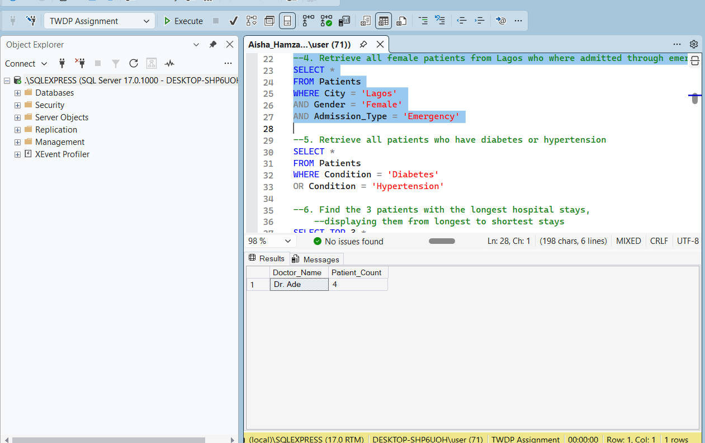
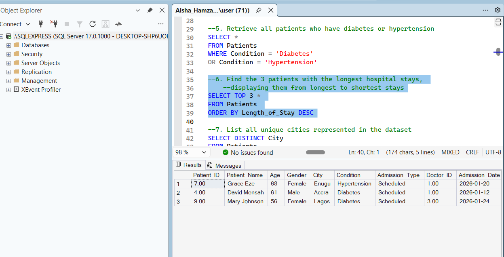
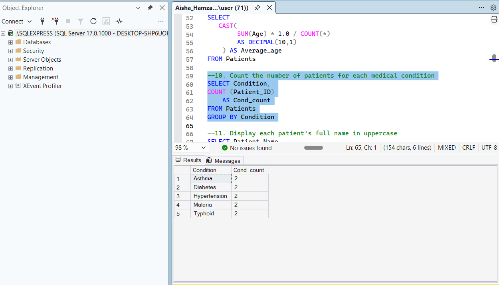
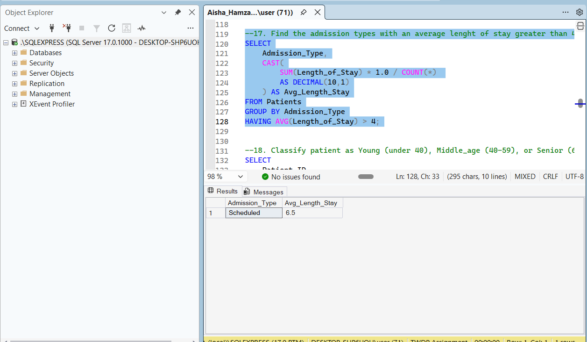
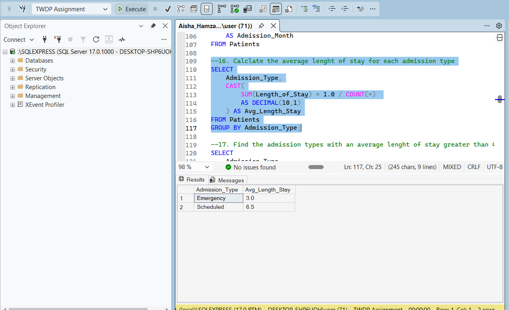
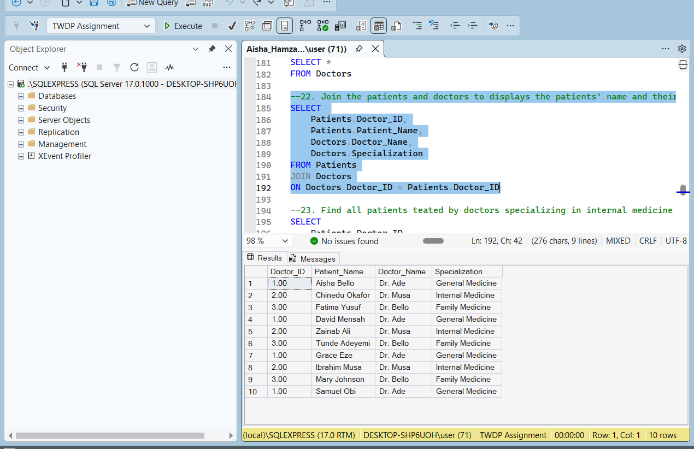
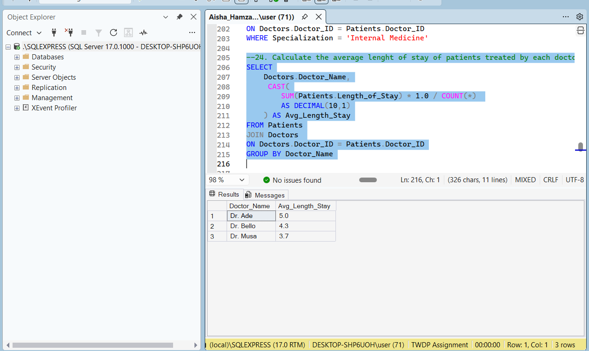
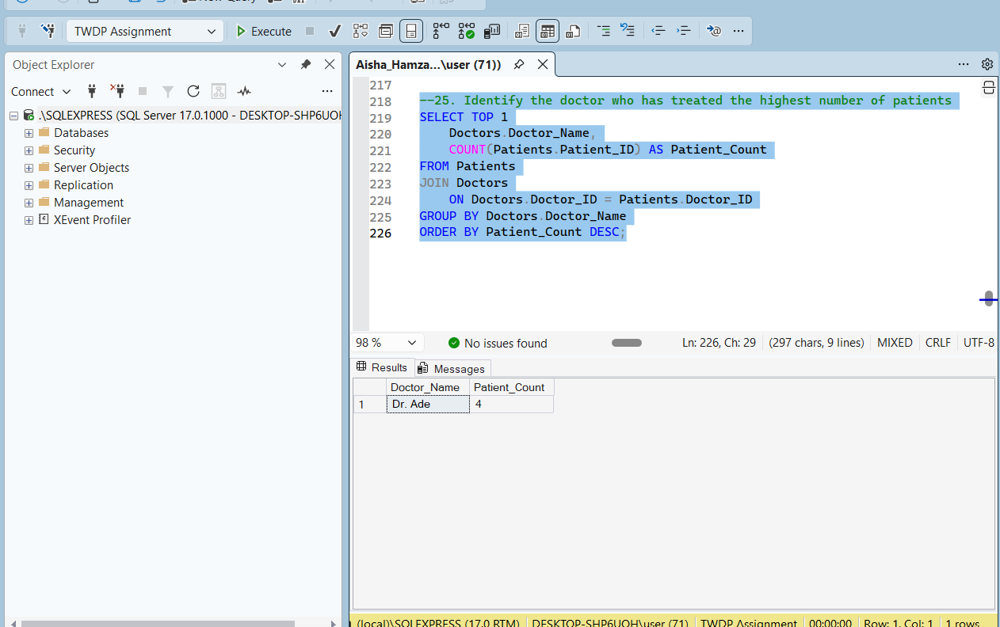

# Hospital Patient Data Analysis with SQL

Using SQL Server, I analysed a hospital patient dataset to answer questions about patient demographics, admissions, length of stay, medical conditions and doctor workload. I wrote 25 queries covering filtering, sorting, aggregation, string and date functions, conditional logic and table joins.

## Table of Contents

- [Introduction](#introduction)
- [Data Overview and Dataset Structure](#data-overview-and-dataset-structure)
- [SQL Queries and Analysis](#sql-queries-and-analysis)
- [Key Findings](#key-findings)
- [Recommendations](#recommendations)
- [Limitations](#limitations)
- [Skills Demonstrated](#skills-demonstrated)
- [Repository Structure](#repository-structure)

## Introduction

Hospitals generate large amounts of data about who is admitted, why, for how long and under whose care. Reading that data well helps management plan beds, staffing and specialist coverage, and spot which conditions and admission routes put the most demand on the hospital.

This project uses SQL to turn a patient dataset into answers to practical questions. The analysis aims to:

- Find specific groups of patients by city, age, gender, condition and admission type.
- Measure length of stay and see which admission types and doctors are linked to longer stays.
- Count patients by medical condition and by age group.
- Work with dates to see when patients were admitted.
- Combine patient and doctor data to see which specializations and doctors carry the most patients.

## Data Overview and Dataset Structure

The analysis uses two related tables in a SQL Server database called `TWDP Assignment`. This is a practice dataset, not real patient data. The source files are in [`data/`](data).

### Patients (10 rows)

| Column | Description |
|---|---|
| Patient_ID | Unique identifier for each patient (primary key) |
| Patient_Name | Patient's full name |
| Age | Patient's age in years |
| Gender | Female or Male |
| City | City where the patient lives |
| Condition | Malaria, Hypertension, Typhoid, Diabetes or Asthma |
| Admission_Type | Emergency or Scheduled |
| Doctor_ID | Links to the Doctors table |
| Admission_Date | Date of admission |
| Length_of_Stay | Number of days spent in hospital |
| Treatment_Status | Recovered or Recovering |

### Doctors (3 rows)

| Column | Description |
|---|---|
| Doctor_ID | Unique identifier for each doctor (primary key) |
| Doctor_Name | Doctor's name |
| Specialization | General Medicine, Internal Medicine or Family Medicine |

The tables are linked by `Doctor_ID`, and every patient has a matching doctor. The data has no missing values.

## SQL Queries and Analysis

The full script is in [`TWDP_SQL_Assignment.sql`](TWDP_SQL_Assignment.sql). The queries are grouped below by the SQL skill they use.

### 1. Filtering Data (Queries 1-5)

**Method:** `WHERE`, `BETWEEN`, `AND` and `OR` to retrieve specific patient groups.

```sql
-- 4. Female patients from Lagos admitted through emergency admission
SELECT *
FROM Patients
WHERE City = 'Lagos'
  AND Gender = 'Female'
  AND Admission_Type = 'Emergency'
```

**Result:**

| Query | Filter | Patients returned |
|---|---|---|
| 1 | City is Lagos | 3 (P001, P005, P009) |
| 2 | Length of stay over 5 days | 3 (P004, P007, P009) |
| 3 | Age between 30 and 50 | 4 (P001, P005, P006, P010) |
| 4 | Female, Lagos, Emergency | 2 (P001, P005) |
| 5 | Diabetes or Hypertension | 4 (P002, P004, P007, P009) |

**Screenshot:**



**Insight:** Lagos is the largest patient city, with 3 of the 10 patients. All three stays over 5 days belong to patients with diabetes or hypertension, and all three are scheduled admissions. The fourth chronic patient, P002, stayed exactly 5 days, so chronic conditions appear to drive longer stays.

### 2. Sorting and Unique Values (Queries 6-7)

**Method:** `ORDER BY` with `TOP 3` to find the longest stays, and `SELECT DISTINCT` to list the cities in the dataset.

```sql
-- 6. The 3 patients with the longest hospital stays
SELECT TOP 3 *
FROM Patients
ORDER BY Length_of_Stay DESC
```

**Result:** The three longest stays are P007 (8 days, hypertension), P004 (7 days, diabetes) and P009 (6 days, diabetes). The patients come from 8 cities: Abuja, Accra, Enugu, Ibadan, Kaduna, Kano, Lagos and Port Harcourt.

**Screenshot:**



**Insight:** All three longest stays are scheduled admissions for chronic conditions (hypertension and diabetes), in patients aged 56 or older. The patients are spread widely, with 7 of the 8 cities having only one patient each.

### 3. Aggregate Functions (Queries 8-10)

**Method:** `COUNT`, `SUM` and `GROUP BY` to count patients, calculate the average age, and count patients for each medical condition. The average age uses `SUM * 1.0 / COUNT` cast to one decimal place, so it isn't rounded down to a whole number.

```sql
-- 9. Average patient age
SELECT CAST(SUM(Age) * 1.0 / COUNT(*) AS DECIMAL(10,1)) AS Average_Age
FROM Patients
```

**Result:** There are 10 patients with an average age of 44.6 years. Each of the five conditions (Asthma, Diabetes, Hypertension, Malaria and Typhoid) has exactly 2 patients.

**Screenshot:**



**Insight:** The patient mix is evenly split across conditions, so no single condition dominates demand.

### 4. String Functions (Queries 11-13)

**Method:** `UPPER`, `LOWER` and `CONCAT` to change the case of patient names and combine `Patient_ID` and `Patient_Name` into one value.

```sql
-- 13. Combine Patient_ID and Patient_Name
SELECT Patient_ID,
       Patient_Name,
       CONCAT(Patient_ID, ' ', Patient_Name) AS Patient_Details
FROM Patients
```

**Result:** For example, `Aisha Bello` becomes `AISHA BELLO` in uppercase and `aisha bello` in lowercase, and the combined value reads `P001 Aisha Bello`.

**Insight:** Standardising text makes names easier to search and match, and a combined ID and name gives a readable label for reports.

### 5. Date Functions (Queries 14-15)

**Method:** A date comparison to find patients admitted after 15 January 2026, then `YEAR` and `DATENAME` to extract the admission year and month name.

```sql
-- 15. Admission year and month
SELECT Patient_ID,
       Patient_Name,
       Admission_Date,
       YEAR(Admission_Date) AS Admission_Year,
       DATENAME(MONTH, Admission_Date) AS Admission_Month
FROM Patients
```

**Result:** 5 patients (P006 to P010) were admitted after 15 January. P005, admitted on 15 January, is excluded because the filter uses `>` and not `>=`. All 10 admissions fall in January 2026.

**Insight:** Admissions are spread evenly across the month, with roughly one new patient every two to three days.

### 6. Grouping and Filtering Groups (Queries 16-17, 21)

**Method:** `GROUP BY` to calculate the average length of stay for each admission type, `HAVING` to keep only admission types averaging more than 4 days, and `HAVING COUNT(*) > 1` to find conditions with more than one patient.

```sql
-- 17. Admission types with an average stay above 4 days
SELECT Admission_Type,
       CAST(AVG(Length_of_Stay * 1.0) AS DECIMAL(10,1)) AS Avg_Length_Stay
FROM Patients
GROUP BY Admission_Type
HAVING AVG(Length_of_Stay * 1.0) > 4
```

`AVG` is multiplied by `1.0` so SQL Server works in decimals. On whole numbers, `AVG` rounds down (4.6 becomes 4), which can wrongly exclude a group from a `> 4` check. It doesn't change the output on this dataset, but it keeps the query correct on other data.

**Result:**

| Admission type | Patients | Average stay (days) |
|---|---|---|
| Emergency | 6 | 3.0 |
| Scheduled | 4 | 6.5 |

Only **Scheduled** admissions average more than 4 days. All five conditions have more than one patient, so query 21 returns all five.

**Screenshots:**

Query 16 (average stay for each admission type):


Query 17 (only admission types averaging more than 4 days):



**Insight:** Scheduled admissions stay more than twice as long as emergency admissions, so they take up far more bed-days per patient.

### 7. Conditional Logic with CASE (Queries 18-20)

**Method:** `CASE` expressions to classify patients as Young (under 40), Middle_age (40 to 59) or Senior (60 and above), count patients in each group, and label stays as Short stay (3 days or less) or Long stay.

```sql
-- 18. Age groups
SELECT Patient_ID,
       Patient_Name,
       Age,
       CASE
           WHEN Age < 40 THEN 'Young'
           WHEN Age BETWEEN 40 AND 59 THEN 'Middle_age'
           ELSE 'Senior'
       END AS Age_Group
FROM Patients
```

**Result:**

| Age group | Patients |
|---|---|
| Young | 4 |
| Middle_age | 4 |
| Senior | 2 |

Four patients have a short stay and six have a long stay.

**Screenshot:**



**Insight:** The two seniors (P004, aged 61, and P007, aged 68) have the 2nd and 1st longest stays (7 and 8 days), so age and length of stay move together here. Most patients (6 of 10) stay longer than 3 days.

### 8. Joins (Queries 22-25)

**Method:** `JOIN` on `Doctor_ID` to connect each patient to a doctor. The joined tables answer four questions: each patient's doctor and specialization, patients treated by Internal Medicine doctors, the average length of stay per doctor, and the doctor who has treated the most patients.

```sql
-- 25. Doctor who has treated the highest number of patients
SELECT TOP 1
       Doctors.Doctor_Name,
       COUNT(Patients.Patient_ID) AS Patient_Count
FROM Patients
JOIN Doctors
    ON Doctors.Doctor_ID = Patients.Doctor_ID
GROUP BY Doctors.Doctor_Name
ORDER BY Patient_Count DESC
```

**Result:**

| Doctor | Specialization | Patients | Average stay (days) |
|---|---|---|---|
| Dr. Ade | General Medicine | 4 | 5.0 |
| Dr. Bello | Family Medicine | 3 | 4.3 |
| Dr. Musa | Internal Medicine | 3 | 3.7 |

All 10 patients matched a doctor. Dr. Musa, the Internal Medicine specialist, treated 3 patients (P002, P005 and P008). Dr. Ade has treated the most patients.

**Screenshots:**

Query 22 (patients with their doctor and specialization):



Query 24 (average length of stay per doctor):



Query 25 (doctor with the most patients):



**Insight:** Dr. Ade carries the heaviest load, with the most patients and the longest average stay (5.0 days), while Dr. Musa has the shortest. The gap is partly down to case mix, since Dr. Ade also has the two oldest patients on the list.

## Key Findings

- The dataset has **10 patients**, **3 doctors** and patients from **8 cities**, with Lagos the largest (3 patients).
- The average patient age is **44.6 years**, and the patients are split evenly across five conditions (2 each).
- **Scheduled admissions stay 6.5 days on average, against 3.0 days for emergencies.** Scheduled is the only type above the 4-day mark.
- The **three longest stays** (6 to 8 days) are all scheduled admissions for hypertension or diabetes, in patients aged 56 or older.
- **Dr. Ade** treated the most patients (4) and has the longest average stay (5.0 days).
- Four patients are Young, four Middle_age and two Senior, and 6 of the 10 patients had a long stay.
- Not covered by the 25 queries, but visible in the data: all 6 emergency patients are marked Recovered, and all 4 scheduled patients are still Recovering.

## Recommendations

1. **Plan bed capacity around scheduled admissions.** They stay more than twice as long as emergencies, so a small number of scheduled patients can use a large share of bed-days.
2. **Focus follow-up on chronic conditions in older patients.** Hypertension and diabetes patients aged 56 and over account for the longest stays, so early discharge planning and outpatient follow-up could shorten them.
3. **Review doctor workload.** Dr. Ade has the most patients and the longest average stay, so consider moving some cases to Dr. Bello or Dr. Musa.
4. **Collect more data before acting.** With 10 patients, these patterns are signals worth checking on a larger dataset, not firm conclusions.

## Limitations

- The dataset has only **10 patients and 3 doctors**, so one patient can change an average noticeably.
- Admissions cover only **January 2026**, so seasonal patterns can't be judged.
- Doctor comparisons are affected by which patients each doctor happens to treat, so they say little about doctor performance.

## Skills Demonstrated

`SELECT` · `WHERE` · `ORDER BY` · `DISTINCT` · `TOP` · `GROUP BY` · `HAVING` · `CASE` · `JOIN` · `COUNT` / `SUM` / `AVG` · `CAST` · `UPPER` / `LOWER` / `CONCAT` · `YEAR` / `DATENAME`

## How to Explore This Project

- **Quick look:** see the query screenshots in [SQL Queries and Analysis](image).
- **PDF:** [Download the analysis as PDF](SQL_Patient_Analysis_Report.pdf)
- **Walkthrough:** [Watch the query demo on Loom](https://www.loom.com/share/9b0700cc94b94a6e9b22ecfd940800c3)
- **Full script:** [View all 25 queries](TWDP_SQL_Assignment.sql).
- **Data:** [`Patients.csv` and `Doctors.csv`](data) are the source tables.
- **Run it yourself:** import the two CSV files into a SQL Server database named `TWDP Assignment`, then open the `.sql` script in [SQL Server Management Studio](https://learn.microsoft.com/sql/ssms/download-sql-server-management-studio-ssms) (free, Windows only) and run the queries.


**Tool:** Microsoft SQL Server (SSMS)

## Repository Structure

```
.
├── README.md
├── TWDP_SQL_Assignment.sql    # all 25 queries
├── data/                      # Patients.csv and Doctors.csv
└── images/                    # screenshots of query results
```

## Author

**Aisha Hamza** | [LinkedIn](https://www.linkedin.com/in/aisha-hamza-a21188187/) | [Email](hamzaaisha798@gmail.com)
